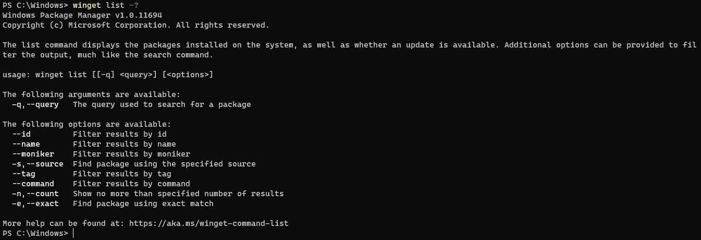
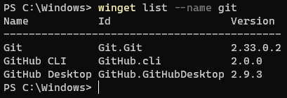
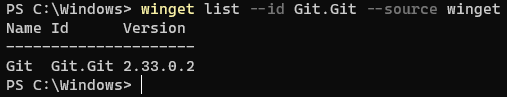
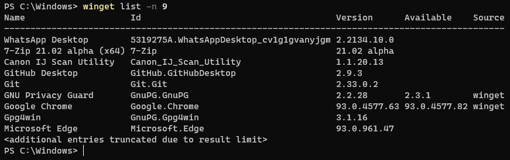
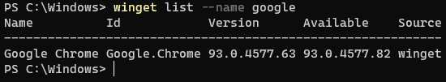

# list command (winget)

The **list** command of the [winget](index.md) tool displays a list of the applications currently installed on your computer.  The list command will show apps that were installed through the Windows Package Manager as well as apps that were installed by other means.

In addition, the **list** command will also display if an update is available for an app, and you can use the [**upgrade**](upgrade.md) command to update the app.

The **list** command also supports filters which can be used to limit your list query.

## Usage

`winget list [[-q] <query>] [<options>]`

The following command aliases are available: \
`ls`



## Arguments

The following arguments are available.

| Argument | Description |
|-------------|-------------|
| **-q,--query** | The query used to search for an app. |

## Options

The options allow you to customize the list experience to meet your needs.
| Option | Description |
|--------|-------------|
| **--id** | Limits the list to the ID of the application. |
| **--name** | Limits the list to the name of the application. |
| **--moniker** | Limits the list to the moniker listed for the application. |
| **-s, --source** | Restricts the list to the source name provided. Must be followed by the source name. |
| **--tag** | Filters results by tags. |
| **--command** | Filters results by command specified by the application. |
| **-n, --count** | Limits the number of apps displayed in one query. |
| **-e, --exact** | Uses the exact string in the list query, including checking for case-sensitivity. It will not use the default behavior of a substring. |
| **--scope** | Select installed package scope filter (user or machine). |
| **--header** | Optional Windows-Package-Manager REST source HTTP header. |
| **--accept-source-agreements** | Accept all source agreements during source operations. |
| **--upgrade-available** | Lists only packages which have an upgrade available. |
| **-u,--unknown,--include-unknown** | List packages even if their current version cannot be determined. Can only be used with the --upgrade-available argument. |
| **--ignore-unknown** | Suppress the summary about skipped packages with unknown versions. Requires `--upgrade-available` and cannot be combined with `--include-unknown`. |
| **--pinned,--include-pinned** | List packages even if they have a pin that prevents upgrade. Can only be used with the --upgrade-available argument. |
| **--sort** | Sort results by a property. Can be repeated for multi-field sorting (e.g., `--sort source --sort name`). Valid values: `name`, `id`, `version`, `source`, `available`, `relevance`. |
| **--ascending,--asc** | Sort results in ascending order (default). |
| **--descending,--desc** | Sort results in descending order. |
| **-?,--help** | Get additional help on this command. |
| **--wait** | Prompts the user to press any key before exiting. |
| **--logs,--open-logs** | Open the default logs location. |
| **--verbose,--verbose-logs** | Enables verbose logging for winget. |
| **--disable-interactivity** | Disable interactive prompts. |

### Example queries

The following example lists a specific version of an application.



The following example lists all application by ID from a specific source.



The following example limits the output of list to 9 apps.



## Ignoring packages with unknown versions

To list available upgrades while silently skipping packages with unknown installed versions, use `winget list --upgrade-available --ignore-unknown`. This does not change package eligibility or suppress other diagnostics. Omit `--ignore-unknown` to restore the default summary. If only ignored packages remain, WinGet reports that no applicable upgrade was found.

## Sorting output

Without a query argument, results default to sorting by name. With a query, results default to sorting by relevance, then by name within each relevance group. A field filter such as `--name` does not replace the name-only default. Relevance compares the match type first (for example, exact matches before substring matches), then the matched field (for example, ID before name).

Names use case-insensitive Windows numeric sorting: otherwise matching names containing `3.1`, `9.0`, and `10.0` appear in that order. This does not normalize different publisher naming or define preview/release-channel precedence. Names that compare equal retain their incoming order unless another sort field breaks the tie.

### Sort via command-line arguments

Use `--sort` to sort by one or more fields. When multiple `--sort` options are specified, results are sorted by the first field, then ties are broken by the second field, and so on.

```cmd
winget list --sort name
winget list --sort relevance --sort name
winget list --sort source --sort name
winget list --sort name --descending
```

`--sort relevance` sorts only by match importance, retaining incoming order within each relevance group. `--sort relevance --sort name` adds natural name ordering within those groups. `--sort name` instead makes name the primary key, regardless of match importance. The selected direction applies to all sort keys; ascending puts the most relevant matches first.

The `search` and `upgrade` commands accept the same sort arguments. They affect package-table presentation, not version ordering or upgrade execution order.

### Sort via user settings

You can set a default sort order in your [settings](https://aka.ms/winget-settings) under `output.sortOrder`:

```json
{
    "output": {
        "sortOrder": ["source", "name"]
    }
}
```

An empty array (`[]`) uses the built-in defaults: `name` without a query; `relevance`, then `name` with a query. `output.sortDirection` selects `ascending` (the default) or `descending`.

These settings also control search results, upgrade lists, and the candidate tables shown when a command finds multiple packages. Fields without a corresponding column in a table do not distinguish its rows. Sorting changes presentation only: it does not change repository/API result ordering, package selection eligibility, or upgrade execution order.

### Resolution order

When both settings and command-line arguments are present, the following priority applies:

1. **`--sort` command-line argument** — takes highest priority, overrides settings.
2. **`output.sortOrder` in settings** — used when no `--sort` argument is provided. If the user has configured a sort order in settings, it is applied even when a query is present.
3. **Built-in defaults** — natural name order without a query; relevance, then natural name order with a query.

Sort direction is resolved separately: an explicit `--ascending` or `--descending` overrides `output.sortDirection`; otherwise the default is ascending. Result limits such as `--count` apply to the repository results before presentation sorting, not to the full installed-package set after sorting. Separate upgrade/pin tables are sorted independently.

## List with Update

As stated above, the **list** command allows you to see what apps you have installed that have updates available.

In the image below, you will notice the current version of **Google Chrome** has an update available.



The **list** command will show not only the update version available, but the source that the update is available from.

## Related topics

* [Use the winget tool to install and manage applications](index.md)
